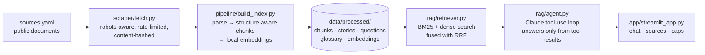

<div align="center">

# 📘 PIR Assistant

**Ask questions about India's Public Insurance Registry — and get answers with page-level citations.**

An unofficial, personal RAG chatbot built on public IRDAI / IIB documents and Claude.

`Python 3.11` · `Streamlit` · `Claude (Haiku / Sonnet)` · `BM25 + embeddings` · `~$0.002 per question`

</div>

> ⚠️ **Disclaimer.** Personal, experimental project. **Not** affiliated with, endorsed by, or speaking for
> IRDAI, IIB or any employer. It uses **public documents only**. Not legal, financial or regulatory advice.
> The consultation paper is a *proposal* — final regulations may differ. Always check the cited source.

---

## About the project: the Public Insurance Registry (PIR)

**PIR** is a proposed *Digital Public Infrastructure for Insurance* in India — a shared, interoperable
registry layer, in the spirit of UPI, credit bureaus and DigiLocker, that connects insurers, intermediaries,
regulators, banks, government bodies and policyholders. IRDAI published a **public consultation paper
(Aug 2026)** to gather views on its scope, design and implementation.

What the paper proposes (all of it is a *proposal*, open for comment):

- **Goals:** facilitate growth and inclusion, build trust and transparency, and promote affordability and
  financial sustainability (§1).
- **Legal anchor:** the *Sabka Bima Sabki Raksha (Amendment of Insurance Laws) Act, 2025*, which amends the
  Insurance Act 1938 and the IRDA Act 1999 (§6).
- **Federated, minimum-data design:** PIR holds only what specific, approved purposes need, in one of three
  modes — a *lightweight reference* to the insurer's record, a *governed central copy* where a genuine
  cross-insurer need exists, or an *anonymised aggregate* for insight. Source systems stay the source of
  record (§10–11).
- **Consent and privacy:** consent that is specific, informed, revocable and auditable, aligned with the
  DPDP Act; PIR keeps consent *records*, while full evidence stays with the regulated entity (§10).
- **Governance:** a public-purpose market infrastructure institution anchored by IRDAI and operated as a
  dedicated institution (§14).
- **Phased rollout:** the user stories are prioritised and delivered in phases, not all at launch (§13).
  The paper gives no go-live date.

**The paper is organised around 59 user stories** across eight stakeholder cohorts, which is why this tool
indexes them as structured records:

| # | Cohort | Stories |
|---|---|---|
| 1 | Public and policyholders (incl. small and medium enterprises) | 12 |
| 2 | Insurers | 16 |
| 3 | Reinsurers | 3 |
| 4 | Insurance intermediaries | 4 |
| 5 | Regulator(s) | 5 |
| 6 | Financial institutions (banks, NBFCs, credit bureaus, rating agencies) | 8 |
| 7 | Government departments and agencies | 10 |
| 8 | Researchers, academia and public-policy institutes | 1 |

Paper structure (16 sections plus a glossary): 1 Overview · 2 Strategic importance · 3 Economic proposition ·
4 Business case · 5 Design principles · 6 Legal anchor · 7 Challenges by cohort · 8 User stories ·
9 Stakeholder value exchange · 10 Privacy, data protection and confidentiality · 11 Data repositories ·
12 Data standards and interoperability · 13 Prioritisation and phasing · 14 Governance ·
15 Consultation questions (14, grouped A–F) · 16 How to send comments · 17 Glossary.

**Sources indexed today**

| Source | Publisher | Status |
|---|---|---|
| PIR Public Consultation Paper (Aug 2026) | IRDAI | Indexed (PDF, downloaded manually) |
| PIR consultation portal (iib.gov.in/pir) | IIB | Indexed |
| Insurance Act 1938 / IRDA Act 1999 as amended by the SBSR Act 2025 | IRDAI | Pending: the site disallows crawling, so the PDFs must be downloaded manually |
| PIB press release on the G20 DPI task force | PIB | Pending: the site returns HTTP 403 to bots |

The assistant is deliberately scoped to this body of public material. Anything outside it gets *"That is
not in the indexed sources"*.

## What it does

Ask in plain English, get a short answer plus the exact passages it came from:

| You ask | You get |
|---|---|
| *"What would PIR hold centrally vs leave with insurers?"* | The three holding modes, the source-system-primacy principle, cited to §11 ¶5 |
| *"How does the paper propose consent to work?"* | Specific, informed, revocable, auditable — cited to §10 ¶3–4 and Story 11 |
| *"How many user stories are there for regulators?"* | A real count from a structured index, not a guess |
| *"What is the go-live date?"* | *"That is not in the indexed sources"* — it does not invent one |

**Design goals:** grounded (no answer without a source) · honest (says when it doesn't know) ·
cheap (pennies per question) · safe to share (password gate, spend caps, public data only).

## How it works



**Why not plain vector search?** The paper has 59 numbered user stories, 14 consultation questions, a
glossary and tables. Counting or listing those is a *lookup* problem, so they are parsed into structured
records and exposed to Claude as tools:

| Tool | Purpose |
|---|---|
| `search_sources` | Hybrid keyword + semantic search with citations |
| `get_story` / `list_stories` | Fetch or enumerate the 59 user stories (by cohort or keyword) |
| `get_question` | The 14 consultation questions (grouped A–F) |
| `define_term` | Glossary / acronym lookup (36 terms) |
| `list_sources` | What is indexed, which version, when it was captured |

Each chunk knows its **section, paragraph, story, cohort and page**, so citations read like
`PIR Consultation Paper (Aug 2026), §11 ¶5 (p.68)`.

## Try it

- **Live app:** _add your Streamlit URL here_ (passphrase-protected)
- **Locally:** see [Quick start](#quick-start)

## Quick start

```bash
git clone https://github.com/SaitejaPagadala/pir-assistant.git
cd pir-assistant
python -m venv .venv && .venv\Scripts\activate        # macOS/Linux: source .venv/bin/activate
pip install -r requirements.txt

cp .env.example .env                                   # then add your ANTHROPIC_API_KEY
```

1. Download the consultation paper yourself and save it as `data/manual/PIR - Public Consultation Paper.pdf`
   (the PDF is not stored in this repo).
2. Build the index:
   ```bash
   python -m scraper.fetch              # polite web fetch; manual files are picked up from data/manual/
   python -m pipeline.build_index       # add --no-embed for keyword-only search
   ```
3. Run:
   ```bash
   streamlit run app/streamlit_app.py
   ```

> The repo already contains a built index in `data/processed/` (183 passages · 59 stories · 14 questions ·
> 36 glossary terms), so for just *running* the app you can skip steps 1–2.

## Configuration

Set in `.env` locally, or in Streamlit Cloud → **Settings → Secrets**:

| Variable | Default | Meaning |
|---|---|---|
| `ANTHROPIC_API_KEY` | — | Your Claude API key (**required**, never commit it) |
| `PIR_MODEL` | `claude-haiku-5-5` | Model for normal answers |
| `PIR_DEEP_MODEL` | `claude-sonnet-5-5` | Model for "Deep" mode |
| `APP_PASSWORD` | *(off)* | If set, visitors must enter this passphrase |
| `MAX_QUESTIONS_PER_SESSION` | `30` | Per-visitor cap |
| `MAX_QUESTIONS_PER_DAY` | `200` | Shared daily cap (resets when the app restarts) |

## Deploy free on Streamlit Community Cloud

1. Push to GitHub — commit `data/processed/`, **never** `.env` or `secrets.toml`.
2. [share.streamlit.io](https://share.streamlit.io) → **New app** → repo `SaitejaPagadala/pir-assistant`,
   branch `main`, main file `app/streamlit_app.py`.
3. **Advanced settings** → Python **3.11** → paste your secrets (table above).
4. Deploy. The first question is slow while the embedding model downloads; later ones are fast.
5. In the Anthropic Console, set a **monthly spend limit** — this is your hard stop on cost.

## Cost

Approximate, at current list prices (check Anthropic's pricing page):

| Mode | Per question | $3.50 budget lasts |
|---|---|---|
| Fast (Haiku) | ≈ $0.002 | ≈ 1,000–1,700 questions |
| Deep (Sonnet) | ≈ $0.04 | ≈ 90 questions |

Guardrails: ≤10 passages per search, answers ≤900 tokens, ≤6 messages of history, ≤5 tool steps.

## Keeping it current

- `data/manifest.jsonl` records a SHA-256 hash each time a source's content **changes** — the raw material
  for a "how has PIR evolved" timeline.
- `.github/workflows/refresh.yml` re-fetches sources weekly, rebuilds the index and commits changes.
- Add sources in `sources.yaml` (`type: pdf|html`, `url` or `file`, `manual: true` for sites that block
  bots). **Only add public, published material.** For news, store a link and your own summary — not the
  full article.

## Quality checks

```bash
python -m pytest -q tests        # chunker unit tests
python -m eval.run_eval          # 10 golden questions against the live agent (~1 cent on Haiku)
```

`eval/golden.yaml` holds questions with expected facts, including a "should say not found" case.
Re-run it after changing prompts, chunking or sources.

## Project layout

```
pir-assistant/
├── sources.yaml            what to index (the source inventory)
├── scraper/                fetch.py (polite fetcher) · parse.py · config.py
├── pipeline/               chunk.py (structure-aware) · build_index.py
├── rag/                    retriever.py · tools.py · agent.py
├── app/streamlit_app.py    the UI
├── eval/                   golden.yaml · run_eval.py
├── tests/                  test_chunk.py
├── data/
│   ├── manual/             PDFs you download yourself (git-ignored)
│   ├── raw/                fetched files (git-ignored)
│   ├── processed/          built index (committed)
│   └── manifest.jsonl      change history
└── .github/workflows/      weekly refresh
```

## Known limitations

- Tables (value exchange, repositories, prioritisation) are chunked by size, not row by row.
- Text inside exhibit images is only captured if the PDF has a text layer.
- Some official sites block bots or disallow crawling in `robots.txt`; those files must be downloaded
  manually and added with `manual: true`.
- Answers can still be wrong. Open the cited passage to verify.

## Roadmap

- [ ] Row-level table chunking
- [ ] "What changed" tool — diff between stored versions of a document
- [ ] More sources: IRDAI circulars and press releases, IIB FAQs, DPDP Act, final PIR regulations
- [ ] Cite question counts and other list answers directly to their source passages

## Responsible use

Public sources only. Respects `robots.txt`, rate-limits requests and identifies itself. Anything from
meetings, working groups or internal discussions must **never** be added here — keep that in a separate,
private deployment.

## License

No license has been chosen yet, so by default all rights are reserved. Add a `LICENSE` file (MIT is a
common choice) if you want others to reuse the code. The indexed documents remain the property of their
publishers.
